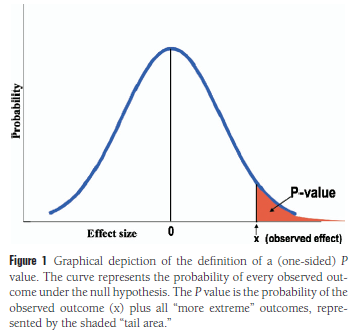

## Introdução

A motivação dos autores foi ensinar aos acadêmicos os erros que são mais cometidos pela 'confiança' que nós atribuímos ao valor-p e abrir outras possibilidades de análise

## O que é o p-valor ?

A formula matemática é dada por $P(X \ge x \mid H_0)$ onde $X$é a variável aleatória da estatística de teste e $x$ é o valor observado na amostra.

## Erros comuns

- Duas amostras de uma mesma população com p-valor distintos dão resultados conflitantes .

- Duas amostras de uma mesma população com o mesmo valor p fornecem a mesma evidência contra a hipótese nula

  

## Erros comuns

- Um p-valor significativo tem efeitos impactantes no resultado observado" .

- Concluir o p-valor como uma desigualdade $p \le 0.05$

- Uma conclusão científica ou política de tratamento deve ser baseada em o valor p ser significativo ou não

## Forma correta de comunicar os resultados

A confiança no uso do p-valor dá uma sensação de que os pesquisadores estão querendo cortar "trabalho ".

Sejamos sinceros ao invés de usarmos 2 ou 3 evidências que indicam o mesmo resultado é menos trabalhosos usar apenas uma evidência só que isso nos dá menos confiabilidade na nossa inferência

## Conclusão

"É a mesma razão pela qual podemos usar o dinheiro. Quando todo mundo acredita no valor de algo, podemos usá-lo para coisas reais; dinheiro para comida, e valores $p$ para alegações de conhecimento, publicação, financiamento e promoção. Não importa se o valor $p$ não significa o que as pessoas pensam que significa; ele se torna valioso por causa do que ele compra." -Steven Goodman

# Bibliografia

- **GOODMAN, Steven.** A dirty dozen: twelve p-value misconceptions. *Seminars in Hematology*, v. 45, n. 3, p. 135-140, 2008\[cite: 1\].
- **WASSERSTEIN, Ronald L.; SCHIRM, Allen L.; LAZAR, Nicole A.** Moving to a world beyond “p \< 0.05”. *The American Statistician*, v. 73, n. sup1, p. 1-19, 2019\[cite: 2\]
